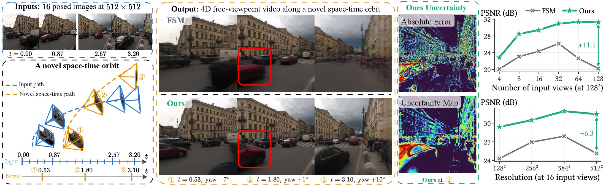

<div align="center">

# A Test-Time Solver for Uncertainty-Aware 4D Novel View Synthesis

[Miaowei Wang](https://wangmiaowei.github.io/)<sup>1</sup>,
[Zhi Cao](https://excitedbutter.github.io/)<sup>2</sup>,
[Jingwei Xu](https://github.com/xjwxjw)<sup>3</sup>,
[Oisin Mac Aodha](https://homepages.inf.ed.ac.uk/omacaod/)<sup>1</sup>,
[Amir Vaxman](https://avaxman.github.io/)<sup>1</sup>

<sup>1</sup>University of Edinburgh &nbsp; <sup>2</sup>Stanford University &nbsp; <sup>3</sup>NovaCore

[**Project page**](https://wangmiaowei.github.io/TTS4D/) &nbsp;|&nbsp;
[**Weights** 🤗](https://huggingface.co/miaoweiwang/TTS4D) &nbsp;|&nbsp;
[**Live demo**](https://wangmiaowei.github.io/TTS4D/demo.html) &nbsp;|&nbsp;
[**Slides**](https://huggingface.co/datasets/miaoweiwang/TTS4D-media/resolve/main/slides/TTS_talk.pptx)



</div>

Transformer-based 4D novel view synthesis struggles to scale to many input views because softmax attention is quadratic in
the number of tokens. Test-time training (TTT) compresses the tokens into fast weights at linear cost, but writes them with
**one gradient step per chunk**: reads become blurred by interference and the memory depends on the token order.
Our **Test-Time Solver (TTS)** layer writes all input tokens into a single fast weight **in closed form**. It is
order-invariant, has a fixed size, trains about 2&times; faster than a comparable TTT memory, and, because the write is a
Bayesian linear regression, its posterior gives a per-pixel **epistemic uncertainty**; a small head adds the aleatoric part.

This repository contains the **inference code** and the released model weights (313 M parameters).

## Installation

```bash
git clone https://github.com/wangmiaowei/TTS4D.git
cd TTS4D
pip install -r requirements.txt      # PyTorch >= 2.4; Triton (ships with PyTorch on Linux/CUDA) enables the fast kernels
```

## Quick start

```python
from tts4d.inference import from_pretrained, load_scene, inputs_of, encode, render_views

model = from_pretrained(device="cuda")                 # downloads tts4d.safetensors from the Hugging Face Hub
sc = load_scene("scene.npz")                           # posed input views (+ optional held-out targets), see below
memory = encode(model, inputs_of(sc, "cuda"))          # the test-time solve: one pass over the input views
out = render_views(model, memory, sc["tgt_c2w"], sc["tgt_K"], sc["tgt_time"], "cuda")
out["rgb"], out["std"], out["log_var_epi"], out["log_var_alea"]   # rendering, predicted std, the two uncertainty terms
```

The weights can also be downloaded once with `python scripts/download_weights.py` and loaded with
`load_model("weights/tts4d.safetensors")`.

**Scene format.** A scene `.npz` holds `inp_image` (uint8, V&times;3&times;H&times;W, H and W multiples of 8), `inp_c2w`
(OpenCV camera-to-world, V&times;4&times;4), `inp_K` (fx, fy, cx, cy in pixels) and `inp_time` (seconds), and optionally the
same `tgt_*` arrays for held-out targets. `tts4d/geometry.py` (`normalize_scene`) brings cameras into the model frame
(first input camera = identity, scale from the inputs only).

The model runs in bfloat16 autocast with the solve in float32; 32 views at 360&times;480 need about 9 GB of GPU memory.

**Fast kernels.** On CUDA with Triton the TTS layers use our custom operators (`tts4d/kernels/`): a fused q/k projection,
normalization and 2D-time RoPE, a bf16 feature map, the sufficient statistics with a hand-written backward, and the
centring, scaling and solve with a **closed-form backward**. They are on by default; `load_model(..., fast=False)` selects
the plain PyTorch reference implementation. Both paths are differentiable, so the layer can be fine-tuned. Without Triton
everything falls back to PyTorch. On our tests the fast path renders the same images as the reference (48&ndash;53 dB
PSNR between the two) and is about 1.3&times; faster with less memory; `tests/` contains the checks:

```bash
python tests/test_kernels.py                                   # each operator: forward vs. reference, backward vs. autograd
python tests/verify_fast_path.py --weights weights/tts4d.safetensors --scene scene.npz   # whole model, fast vs. reference
```

## Notebooks

| notebook | what it shows |
|---|---|
| [`notebooks/fit_one_scene.ipynb`](notebooks/fit_one_scene.ipynb) | one dynamic scene (DyCheck *handwavy*, 32 views): solve once, render held-out views, uncertainty vs. error, order invariance, a novel camera path (executed, outputs included) |
| [`notebooks/tts_vs_ttt_memory.ipynb`](notebooks/tts_vs_ttt_memory.ipynb) | **TTS vs. TTT** on the write operation alone, no weights or data needed: recall of written tokens as the number of views grows, sensitivity to the token order, where each read comes from, and the speed of a training step |

## Evaluation, data and applications

**1. Prepare a benchmark** (converts the raw data into scene `.npz` files with the input/target split of the paper):

```bash
python scripts/prepare_benchmark.py --benchmark dycheck --root /path/to/DyCheck --out data --n_in 16 32 64
#   --benchmark: stereo4d, stereo4d_interp, dycheck, dycheck_novel, nvidia, nvidia_bullet, dl3dv, mip360, tandt
```

**2. Evaluate** (PSNR / SSIM / LPIPS and the uncertainty metrics, Pearson and AUSE for L1 and DSSIM, per number of views):

```bash
python scripts/eval_benchmark.py --data data/dycheck --out results/dycheck     # writes table.md / table.json
```

The metrics in `tts4d/metrics.py` follow each benchmark's protocol (masked metrics for DyCheck novel views, the NVIDIA
protocol, the 3DGS protocol for Mip-NeRF 360 and Tanks and Temples, the GS-U protocol for AUSE).

**3. Render a video** along a novel camera path, with the uncertainty next to it:

```bash
python scripts/render_video.py --scene data/dycheck/N32/apple.npz --out apple.mp4 --path bullet   # trajectory, bullet, orbit, orbit360, fixed
```

**4. Active view selection** (supplementary): start from 4 views of Mip-NeRF 360 *bonsai*, repeatedly add the candidate view
with the highest predicted uncertainty, and score held-out views against random / farthest-camera selection:

```bash
python scripts/active_view_selection.py --root /path/to/mipnerf360 --out avs --n_start 4 --n_final 20
```

Notes: the released checkpoint is the one of the paper's 4D tables; the static-scene tables of the supplementary used a later
checkpoint, so those numbers differ slightly. Stereo4D right-eye targets use a public perspective conversion of the right-eye
videos (see `tts4d/data/stereo4d.py`).

## How the model works, in code

```
tts4d/
  tts_layer.py   TTS layer: closed-form centred & scaled ridge solve, read, epistemic scalar u(q)
  model.py       TTS4D: patch tokens (Plücker rays + time + RGB), 24 layers, RGB decoder, uncertainty head
  blocks.py      one layer = within-view self-attention + TTS layer (all views) + MLP
  rope.py        2-D + time rotary embedding of the TTS layer's q / k
  geometry.py    Plücker rays, scene normalisation (first input camera = identity, input-only scale)
  inference.py   model / scene loading, batched rendering, PSNR, training-free grid removal, uncertainty colouring
  kernels/       fast operators: Triton kernels + closed-form backward passes (fused q/k + 2D-time RoPE, feature map,
                 sufficient statistics, centred solve, q/k RMSNorm)
  metrics.py     PSNR / SSIM / LPIPS per benchmark protocol, uncertainty Pearson and AUSE
  runner.py      batched scene rendering used by the scripts
  data/          benchmark converters (Stereo4D, DyCheck, NVIDIA, static scenes) to the scene format
configs/tts4d.json   hyper-parameters of the released model
scripts/        prepare_benchmark.py, eval_benchmark.py, render_video.py, active_view_selection.py, download_weights.py
tests/          kernel and fast-path checks
```

* `encode(inputs)` runs the input views through the network. In each of the 24 TTS layers the input tokens are written into
  **one fast weight** by a closed-form ridge regression (`TTSLayer.solve`): five sufficient statistics are summed over
  tokens, centred, scaled and solved with one Cholesky factorization. The state has a fixed size for any number of input
  views and does not depend on their order.
* `render(memory, queries)` renders any number of query views (camera + time) from that state; query tokens only **read**
  the memory, so a scene is solved once and then rendered from any camera and time.
* Uncertainty: every TTS layer also returns the posterior variance `u_l(q)` of the query read. The epistemic log-variance is
  `U_epi = beta_0 + sum_l beta_l log(u_l / u_bar_l)`; the total adds a learned aleatoric term, and `exp(U/2)` is the
  predicted standard deviation.

Training code and the interactive web viewer are not included; everything else used in the paper is.

## Citation

```bibtex
@article{wang2026tts,
  title   = {A Test-Time Solver for Uncertainty-Aware 4D Novel View Synthesis},
  author  = {Wang, Miaowei and Cao, Zhi and Xu, Jingwei and Mac Aodha, Oisin and Vaxman, Amir},
  journal = {arXiv preprint},
  year    = {2026}
}
```

## Acknowledgements and license

The network layout (patch tokens with Plücker rays, within-view attention interleaved with a fast-weight layer across views)
follows the publicly released [LaCT](https://github.com/a1600012888/LaCT) and FSM code bases; the TTS layer, the uncertainty
head and this implementation are ours. The code is released under the [MIT License](LICENSE).
